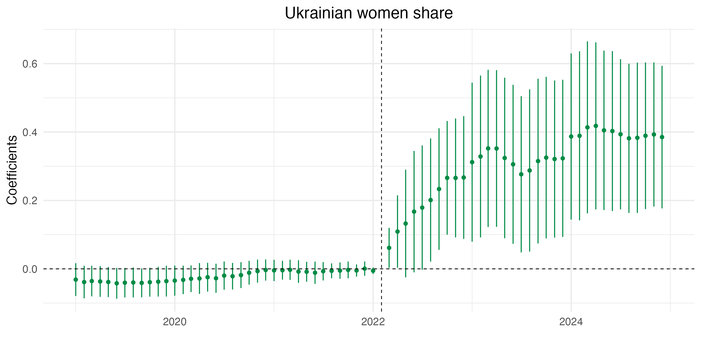

# The Labour Market Effects of Refugee Immigration: Evidence from Ukraine

This repository quantifies the impact of the Ukrainian refugee influx on the
Lithuanian labour market following Russia's full-scale invasion of Ukraine in
February 2022. Using a spatial difference-in-differences design on monthly
social security data, I find that the influx of female refugees had **no
significant effect on native women's employment rates or real wages**, pointing
to limited substitutability between Ukrainian and Lithuanian female workers.
The outflow of Ukrainian men had no conclusive effect on the labour market
outcomes of Lithuanian men.

This repository contains the code for my bachelor's thesis in Quantitative
Economics at Vilnius University ([full thesis](https://virtualibiblioteka.vu.lt/permalink/370LABT_VU/1m1kbf3/alma9913625423908452)).



## Identification

The identification strategy relies on network effects: municipalities with
larger Ukrainian communities before the war are assumed to have attracted more
refugees after the invasion. Treatment is assigned by each municipality's
pre-war (2015–2018) share of Ukrainians, excluding the transport sector.
Municipalities with at least 1% of all Ukrainians in Lithuania are treated
(10 treated, 50 control).

- **Dynamic event study:** month × treatment interactions with municipality
  and month fixed effects; February 2022 is the reference period.
- **Static difference-in-differences**, in four specifications:
  1. baseline two-way fixed effects
  2. pre-war municipality characteristics interacted with a linear trend
  3. treated municipalities matched to bordering controls
  4. population-weighted
- **Robustness:** alternative treatment thresholds (0.5% and 2%).

Standard errors are clustered at the municipality level (matched group in
specification 3).

## Results

- **First stage:** municipalities with larger Ukrainian communities before the
  war attracted significantly more female refugees after the invasion. In the
  baseline model, the Ukrainian women share increased by 0.33 percentage points
  more in treated municipalities than in control municipalities.
- **Native women:** the influx of female refugees had no significant effect on
  native women's employment rates or real wages. Ukrainian women persistently
  had lower wages than Lithuanian women, indicating that they likely occupied
  different jobs.
- **Native men:** the war also triggered an outflow of Ukrainian men; however,
  there is no conclusive evidence that the outflow significantly impacted the
  labour market outcomes of Lithuanian men.
- **Firms and skills:** no robust evidence was found of an impact on the number
  of firms or the skill composition of the labour force, with significance
  attributed to long-term trends rather than a response to the influx.
- **Fiscal contribution:** from March 2022 to December 2024, female refugees
  generated a wage bill of €355 million, paid €71 million in income tax and
  €69 million to SoDra in social and health insurance contributions.

Taken together, the findings suggest that the influx of Ukrainian refugees had
a modest impact on the Lithuanian labour market and did not harm local workers.

All figures and tables are in [`thesis_results/`](thesis_results/). See the
correction below for how the static tables differ from the thesis PDF.

## Correction to the robustness checks

While preparing this repository, I found a bug in the original code for the
heterogeneous-trends specification. The tables in `thesis_results/` use the
corrected code, so some of them differ from the thesis PDF.

**The bug.** The linear time trend was created after merging the panel with the
municipality controls, using a column from the pre-merge data:

```r
# Original
dynamic_women_tr <- merge(dynamic_women_tr, df_controls_fixed, by = 'municipality') %>%
  mutate(time_trend = as.numeric(factor(dynamic_women_tr$date)))

# Corrected
dynamic_women_tr <- merge(dynamic_women_tr, df_controls_fixed, by = 'municipality') %>%
  mutate(time_trend = as.numeric(factor(date)))
```

The pre-merge data was sorted by date, while `merge()` returns rows sorted by
municipality. The trend values were therefore attached to the wrong rows: each
municipality received an almost constant value instead of a trend running from
1 to 72. This was absorbed by the municipality fixed effects, so the
heterogeneous-trends controls had effectively no effect in columns (2)–(4).

**What is affected.** Columns (2)–(4) of the static tables for Ukrainian
women's share, employment and wages, Lithuanian women's employment, wages and
migration, and the corresponding tables for men (thesis Tables 2–7 and
A.1–A.4). The baseline estimates (column 1), all event studies, the firm and
skill composition results (Tables 8, 9, A.5–A.7) and the wage bill are
unchanged.

**What changes.**

- **First stage:** still positive in all specifications, but weaker. The
  heterogeneous-trends and weighted estimates fall from about 0.33 to 0.16–0.18
  percentage points and are significant at the 10% level.
- **Native women's employment:** the small positive effects in the matched and
  weighted models disappear; no specification shows a significant effect.
- **Native wages:** the matched-neighbours model now shows significant negative
  effects for Lithuanian women and men. These are not confirmed by any other
  specification or by the event studies, and the matched model clusters
  standard errors at only 10 matched groups, which tends to overstate
  significance.

The main conclusions of the thesis remain unchanged, but the robustness of the
first stage is weaker than reported, and the wage results are no longer
insignificant in every specification.

## Data

The thesis uses confidential monthly data from Lithuania's State Social
Insurance Fund Board (SoDra), aggregated to 60 municipalities. **It is not
included.** The `.dta` files in `data/` are synthetic: same structure, so all
code runs unchanged, but values come from arbitrary rules (see
[`data/README.md`](data/README.md) and
[`R/make_synthetic_data.R`](R/make_synthetic_data.R)). Running the code
therefore does **not** reproduce the thesis estimates.

CPI data: Statistics Lithuania. Municipality boundaries: © OpenStreetMap
contributors (ODbL).

## Repository structure

```
.
├── R/
│   ├── 00_load_data.R              # loads and prepares all data
│   ├── functions.R                 # event study, static DiD, plotting functions
│   ├── 01_treatment.R              # summary statistics, treatment and matching maps
│   ├── 02_main_regressions.R       # first stage, Ukrainian and Lithuanian outcomes
│   ├── 03_further_implications.R   # firms and skill composition
│   ├── 04_fiscal_contribution.R    # refugee wage bill and taxes
│   ├── 05_stylised_facts.R         # descriptive time series
│   ├── make_synthetic_data.R       # generates the synthetic data in data/
│   └── run_all.R                   # runs the full pipeline
├── data/                           # synthetic SoDra files, CPI, map boundaries
├── thesis_results/                 # figures and tables from the real data
├── figures/                        # code output (not committed)
├── tables/                         # code output (not committed)
└── Repo.Rproj                      # RStudio project file
```

## How to run

1. Clone the repository and open `Repo.Rproj` in RStudio.
2. Install the packages with `renv::restore()`. renv activates automatically
   when you open `Repo.Rproj`; this installs the exact package versions used.
3. Run `source("R/run_all.R")`. Figures and tables are written to `figures/`
   and `tables/`.

## Tools

R · `fixest` (fixed-effects regressions) · `tidyverse` · `haven` · `sf`
(maps) · `broom` · `knitr` · `here` · `renv`

## Acknowledgements

Thesis supervised by Dr. Jose Garcia-Louzao Perez, Faculty of Economics and
Business Administration, Vilnius University.
